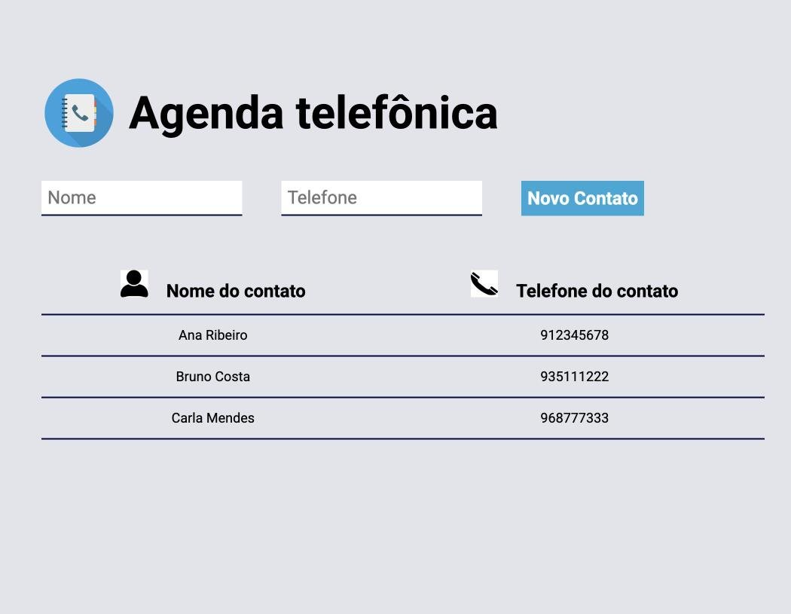

# 📒 Agenda telefónica

Pequena aplicação para **registar contactos** (nome e telefone) numa tabela, sem recarregar a página. Foi um dos meus primeiros exercícios de **JavaScript com manipulação do DOM**.

🔗 **Demo:** [hanna-projeto-agenda-telefonica.vercel.app](https://hanna-projeto-agenda-telefonica.vercel.app)




---

## ✨ O que pratiquei

- Captura do evento `submit` do formulário com `addEventListener`
- `preventDefault()` para evitar o recarregamento da página
- Leitura dos campos com `getElementById` e criação dinâmica de linhas na tabela
- Limpeza dos campos depois de cada registo
- Validação nativa do HTML (`required`, campo numérico para o telefone)

## 📁 Estrutura

```
├── images/      # Ícones
├── index.html   # Página
├── main.css     # Estilos
└── main.js      # Lógica do formulário e da tabela
```

## ▶️ Como ver

Abre o `index.html` no browser ou visita a [demo](https://hanna-projeto-agenda-telefonica.vercel.app).

## 📚 Contexto

Projeto desenvolvido no âmbito da formação **Full Stack Java da EBAC** (módulo de JavaScript), em 2023.

---

Desenvolvido por **Hanna Sampaio** · [LinkedIn](https://www.linkedin.com/in/hannasampaio7/) · [GitHub](https://github.com/hannasampaio)
